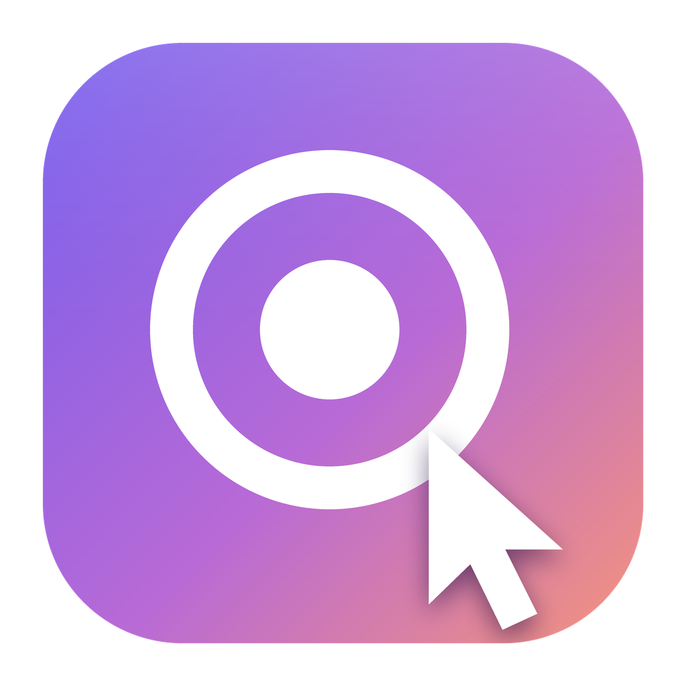

<p align="center">
  
</p>

<h1 align="center">Recorder Studio</h1>

<p align="center">
  <strong>Free, open-source screen recorder and cinematic editor for Windows.</strong><br>
  Smooth cursor, automatic zooms, camera layouts, Reels / Shorts format and fast GPU export. Everything runs on your computer.
</p>

<p align="center">
  <a href="https://github.com/uz4studiosuz/Recorder-Studio/releases/latest"></a>
  <a href="https://github.com/uz4studiosuz/Recorder-Studio/releases"></a>
  
  <a href="LICENSE"></a>
</p>

<p align="center">
  <a href="https://github.com/uz4studiosuz/Recorder-Studio/releases/latest/download/Recorder-Studio-Setup-x64.exe"><b>⬇ Download installer</b></a>
  &nbsp;·&nbsp;
  <a href="https://github.com/uz4studiosuz/Recorder-Studio/releases/latest/download/Recorder-Studio-Portable-x64.exe">Portable .exe</a>
  &nbsp;·&nbsp;
  <a href="https://uz4studiosuz.github.io/Recorder-Studio/">Website</a>
  &nbsp;·&nbsp;
  <a href="WINDOWS_BUILD.md">O‘zbekcha qo‘llanma</a>
</p>

---

## Contents

- [Highlights](#highlights)
- [Download and install](#download-and-install)
- [Quick start](#quick-start)
- [Features](#features)
- [Keyboard shortcuts](#keyboard-shortcuts)
- [Build from source](#build-from-source)
- [Project structure](#project-structure)
- [Privacy](#privacy)
- [Known limits](#known-limits)
- [Changelog](#changelog)
- [Contributing](#contributing)
- [License](#license)

## Highlights

| | |
| --- | --- |
| 🎬 **Mini recorder** | A compact floating bar opens at startup: pick a screen, turn on the mic or camera, and press Record. Recordings open straight in the editor. |
| ⚡ **Fast stop and export** | Recording and export use your GPU (NVIDIA NVENC, Intel Quick Sync, AMD AMF) with CPU fallback. Export encodes frames with WebCodecs on the GPU instead of copying raw frames. |
| 🖱️ **Cinematic cursor** | A smooth vector cursor with click ripples, highlight and idle hiding, plus automatic zooms on your clicks. |
| 📱 **Reels / Shorts** | Record in 16:9 and switch to 9:16 later. The frame follows your cursor so text stays readable. |
| 🎥 **Camera layouts** | Screen only, camera overlay, split screen, full camera, and background-removed camera cutout. Screen and camera stay on separate tracks, so you can change the layout after recording. |
| 🔒 **Local by default** | No account, no upload, no telemetry. Background removal runs on your device. |

## Download and install

1. Open the [latest release](https://github.com/uz4studiosuz/Recorder-Studio/releases/latest).
2. Download one of these files:
   - **`Recorder-Studio-Setup-x64.exe`** installs the app and adds Start menu and desktop shortcuts. Recommended.
   - **`Recorder-Studio-Portable-x64.exe`** is a single file that runs without installing.
3. Windows SmartScreen may warn that the publisher is unknown, because the build is not code-signed yet. Choose **More info → Run anyway**.

**Requirements:** Windows 10 or 11, 64-bit. A GPU with hardware H.264 encoding makes stop and export much faster. Without one, the app falls back to the CPU.

## Quick start

1. **Start the app.** The mini recorder bar appears at the bottom of the screen.
2. **Choose a source.** Click the source button to open the setup panel. You can pick a screen or window from live thumbnails, see the camera preview, and check the microphone level or record a 5-second test.
3. **Pick a format.** Choose **16:9** for landscape or **Reels** for 9:16. You can change it later in the editor.
4. **Record.** A 3-2-1 countdown appears (you can set it to 0, 3 or 5 seconds), then recording starts. Stop it with the floating bar or `Ctrl+Shift+F9`.
5. **Edit.** The recording opens in the editor. Cut, trim, reorder, change the camera layout, and style the frame.
6. **Export.** Export MP4 (720p / 1080p / 4K, 24–60 fps) or GIF, either to a file or to the clipboard.

If you want the full recording page with Reels region capture and appearance setup, use **Open full studio** on the bar, then **New recording**.

## Features

### Recording
- Record a full monitor or a single window at 60 fps. The Windows cursor is left out of the video and redrawn as a smooth vector cursor.
- Record microphone, system audio (loopback) and webcam, each as an optional input with its own clear error message.
- **Reels region:** capture only a 9:16 area of the screen.
- **Reels follow:** record the full screen, and the 9:16 editor follows your cursor.
- Recordings are encoded on the GPU in real time, so Stop no longer waits for a CPU backlog to drain.
- Optional on-screen keystrokes (shortcuts and typing).
- Zoom markers during recording (`Ctrl+Shift+M`).

### Editing
- Thumbnail timeline with split, trim, ripple delete, reorder, snapping, and undo / redo.
- Automatic zooms grouped from your clicks, plus manual zoom segments with an editable focus point.
- **Reels mode:** in 9:16, click zooms are paused, because the follow crop is already close. Switch back to 16:9 and they come back.
- Camera layouts: overlay (circle, squircle, rounded, wide, portrait), split screen (adjustable side and share), full camera, and cutout.
- Backgrounds: gradients, solid colours, or your own image. Frame padding, corner radius and shadow are adjustable.
- Per-clip appearance: give one clip its own look, or apply a look to all clips.
- Click sounds, including a chalk-style sound for drags. Volume and speed control.
- Projects save automatically to a local library. Export a portable `.rsproject` bundle to move a project to another computer.

### Export
- MP4 (H.264 + AAC) at 720p, 1080p or 4K, 24, 30 or 60 fps, with quality presets. Landscape and portrait (720×1280 up to 2160×3840).
- GIF at 15, 20 or 30 fps, up to 60 seconds.
- **GPU export path:** the canvas → WebCodecs `VideoEncoder` → H.264 stream → FFmpeg muxes it with audio, without re-encoding the video. On a typical Intel iGPU this runs at about 2× real time at 1080p60.
- Save to a file or copy the file to the clipboard.

## Keyboard shortcuts

| While recording | |
| --- | --- |
| `Ctrl+Shift+F9` | Stop and open the editor |
| `Ctrl+Shift+M` | Add a zoom marker at the cursor |
| `Ctrl+Shift+H` | Hide or show the recording bar |

| In the editor | |
| --- | --- |
| `Space` | Play or pause (at the end, Play starts again from the beginning) |
| `Ctrl+B` | Split at the playhead |
| `Delete` / `Backspace` | Delete the selection |
| `Ctrl+Z` · `Ctrl+Shift+Z` / `Ctrl+Y` | Undo · redo |
| `Ctrl+S` | Save the project |
| `Ctrl` `+` / `-` / `0` | Timeline zoom in / out / fit |
| `↑` / `↓` | Jump to the previous / next cut |
| `S` | Toggle snapping |
| `F` / `F11` · `Esc` | Fullscreen preview · exit or clear the selection |

## Build from source

Requirements: Windows 10/11 x64, **Node 24 LTS x64** (minimum 22.12), and npm.

```powershell
git clone https://github.com/uz4studiosuz/Recorder-Studio.git
cd Recorder-Studio
npm ci
npm run setup:win     # verifies FFmpeg and the native modules
npm run dev           # starts the app with hot reload
```

| Command | What it does |
| --- | --- |
| `npm run dev` | Runs the desktop app in development mode (`--studio` opens the full studio instead of the mini bar) |
| `npm run dev:web` | Runs the editor preview in a browser. Recording and export need the desktop app. |
| `npm test` | Runs the unit tests (Vitest) |
| `npm run build` | Typechecks and builds the renderer and the Electron main process |
| `npm run test:desktop` | Boots the built app and checks the sandboxed preload bridge |
| `npm run test:playback` | Checks frame-exact playback and audio after cuts, using synthetic fixtures |
| `npm run test:integration` | Makes real short screen recordings and exports. Run it only when your screen is free. |
| `npm run dist:win` | Builds the NSIS installer and the portable exe into `release/` |

> If `npm ci` with npm 11 skips install scripts, run `node node_modules/electron/install.js` once so Electron downloads its binary.

### Publishing a release

1. Update `version` in `package.json` and add a Changelog entry.
2. Run `npm run dist:win`.
3. Create a GitHub release tagged `vX.Y.Z` and attach `release/Recorder-Studio-Setup-x64.exe` and `release/Recorder-Studio-Portable-x64.exe`.

Because the file names do not include the version, the links ending in `/releases/latest/download/…` (used in this README and on the website) always point to the newest release.

## Project structure

```
electron/   main process: windows, native capture (FFmpeg gdigrab + GPU encoder), export muxing, media protocol
src/        React renderer: mini recorder (Launcher), recording page, editor, compositor, WebCodecs exporter
shared/     types and timeline maths shared by both sides
website/    static landing page (GitHub Pages ready)
scripts/    dev runner, smoke / playback / integration tests, packaging hooks
```

More detail: [Architecture](docs/architecture.md) · [Verification](docs/verification.md) · [Third-party notices](THIRD_PARTY.md)

## Privacy

Recorder Studio has no accounts, servers or analytics. Recordings, projects and exports stay in `Videos\Recorder Studio` and in the app's user-data folder. Background removal (MediaPipe Selfie Segmenter) runs entirely on your device. The only network requests are made when you open a link, such as Unsplash or GitHub, yourself.

## Known limits

- Windows is the supported platform. macOS has an untested monitor-capture adapter, and macOS window capture is not available.
- GDI capture may not record protected or some GPU-only surfaces.
- The installer is not code-signed yet, so SmartScreen shows a warning.
- This is a single-source editor with multiple retained or reordered ranges. It is not a general multi-track NLE.

## Changelog

### 0.6.0
- **New mini recorder.** A compact floating bar opens at startup. It has live screen thumbnails, a camera preview, a microphone level meter with a 5-second test, a camera layout picker, and a countdown setting. Finished recordings open straight in the editor.
- **3-2-1 countdown** before recording, set to 0, 3 or 5 seconds.
- **Much faster Stop.** Live capture uses NVENC, Quick Sync or AMF. The extra full-file rewrite at stop (`+faststart`) is gone, and the screen file is renamed instead of copied.
- **Much faster export.** Frames are encoded with WebCodecs on the GPU. FFmpeg only muxes audio.
- **Fixed:** camera and voice were out of sync in exports. Audio leading silence was being dropped and pulled speech about 0.7 s ahead of the picture.
- **Fixed:** finalization failed on some webcams that report a 1000 fps timebase. The camera track is now normalized to a constant 30 fps, with a CPU fallback.
- **Split screen** now follows the cursor in both 16:9 and 9:16.
- **Reels:** click zooms pause in 9:16 and return when you switch back to 16:9.
- **Editor:** pressing Play at the end restarts from the beginning. The inspector is driven by the Video / Camera / Canvas picker. Only the 16:9 and 9:16 formats are offered.

### 0.5.1
- Correct byte-range responses for media playback, which fixes stale frames after cuts.

### 0.5
- Full-page recording workspace, local project library, hardware encoders for export, and concurrent finalization.

## Contributing

Issues and pull requests are welcome: [open an issue](https://github.com/uz4studiosuz/Recorder-Studio/issues). Before a PR, please run `npm run typecheck`, `npm test` and `npm run test:desktop`.

## License

The app code is [MIT](LICENSE). The bundled FFmpeg binary is GPLv3, and its notices ship with it. Timeline snapping adapts MIT-licensed code from OpenCut Classic (see `THIRD_PARTY_OPENCUT_LICENSE`). No proprietary wallpapers are included.
